# Median of Two Sorted Arrays

## Решение

### Обзор

Даны два отсортированных массива `nums1` и `nums2`. Нужно вернуть медиану этих двух массивов.

---

## Подход 1: Merge Sort

### Идея

Начнём с самого прямого подхода. Если сложить элементы обоих массивов в один массив `A` и упорядочить его, то при длине объединённого массива `n` медиана равна:

- `A[n / 2]`, если `n` нечётно;
- среднему `A[n / 2]` и `A[n / 2 + 1]`, если `n` чётно.

Но на самом деле полностью сливать и сортировать массивы не нужно. Оба массива уже отсортированы, поэтому наименьший элемент — это либо первый элемент `nums1`, либо первый элемент `nums2`. Можно поставить два указателя `p1` и `p2` в начало каждого массива и на каждом шаге брать меньший из `nums1[p1]` и `nums2[p2]`.

Пример на слайдах:

**1 / 12**

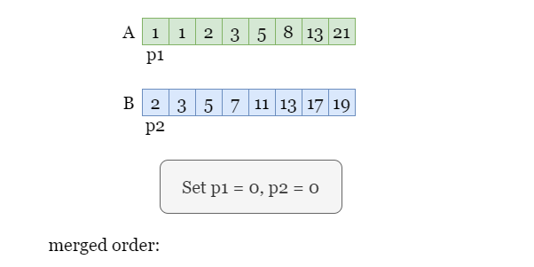

**2 / 12**


**3 / 12**

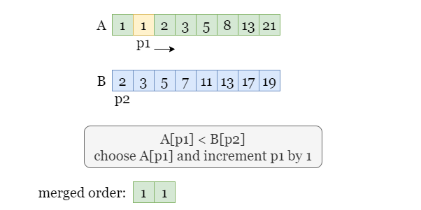

**4 / 12**

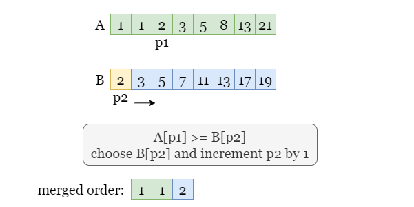

**5 / 12**

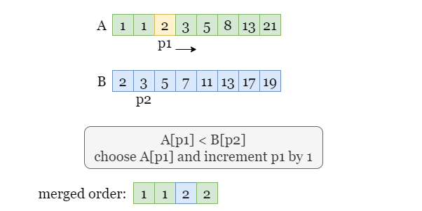

**6 / 12**


**7 / 12**

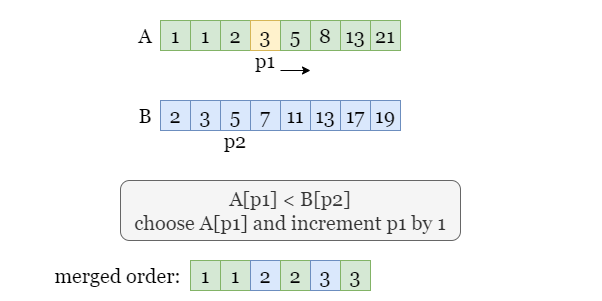

**8 / 12**

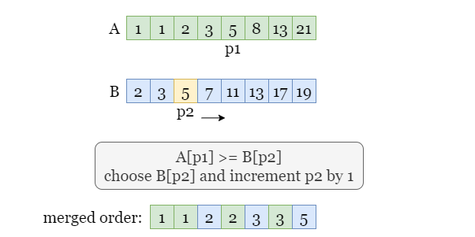

**9 / 12**


**10 / 12**


**11 / 12**


**12 / 12**


### Алгоритм

1. Найти суммарный размер двух массивов `m + n`.
   - Если `m + n` нечётно, ищем `(m + n) / 2`-й элемент.
   - Если `m + n` чётно, ищем среднее `(m + n) / 2`-го и `(m + n) / 2 + 1`-го элементов.
2. Поставить указатели `p1` и `p2` в начало `nums1` и `nums2`.
3. Если оба указателя в пределах массивов, сравнить значения в `p1` и `p2`:
   - если `nums1[p1]` меньше `nums2[p2]`, сдвинуть `p1` вправо;
   - иначе сдвинуть `p2` вправо;
   - если `p1` вышел за пределы `nums1`, просто сдвинуть `p2` вправо;
   - если `p2` вышел за пределы `nums2`, просто сдвинуть `p1` вправо.
4. Найти нужные элементы и посчитать медиану:
   - если `m + n` нечётно, повторить шаг 3 `(m + n + 1) / 2` раз и вернуть элемент с последнего шага;
   - если `m + n` чётно, повторить шаг 3 `(m + n) / 2 + 1` раз и вернуть среднее элементов с двух последних шагов.

### Реализация

```javascript
var findMedianSortedArrays = function (nums1, nums2) {
    let m = nums1.length,
        n = nums2.length;
    let p1 = 0,
        p2 = 0;

    let getMin = function () {
        if (p1 < m && p2 < n) {
            return nums1[p1] < nums2[p2] ? nums1[p1++] : nums2[p2++];
        } else if (p1 < m) {
            return nums1[p1++];
        } else if (p2 < n) {
            return nums2[p2++];
        }
        return -1;
    };

    if ((m + n) % 2 === 0) {
        for (let i = 0; i < (m + n) / 2 - 1; ++i) {
            let temp = getMin();
        }
        return (getMin() + getMin()) / 2.0;
    } else {
        for (let i = 0; i < Math.floor((m + n) / 2); ++i) {
            let temp = getMin();
        }
        return getMin();
    }
};
```

```python
class Solution:
    def findMedianSortedArrays(
        self, nums1: List[int], nums2: List[int]
    ) -> float:
        m, n = len(nums1), len(nums2)
        p1, p2 = 0, 0

        # Get the smaller value between nums1[p1] and nums2[p2].
        def get_min():
            nonlocal p1, p2
            if p1 < m and p2 < n:
                if nums1[p1] < nums2[p2]:
                    ans = nums1[p1]
                    p1 += 1
                else:
                    ans = nums2[p2]
                    p2 += 1
            elif p2 == n:
                ans = nums1[p1]
                p1 += 1
            else:
                ans = nums2[p2]
                p2 += 1
            return ans

        if (m + n) % 2 == 0:
            for _ in range((m + n) // 2 - 1):
                _ = get_min()
            return (get_min() + get_min()) / 2
        else:
            for _ in range((m + n) // 2):
                _ = get_min()
            return get_min()
```

### Анализ сложности

Пусть `m` — размер `nums1`, а `n` — размер `nums2`.

**Время:** `O(m + n)`

- Меньший элемент находится сравнением значений в `p1` и `p2`; сравнение и сдвиг указателя занимают `O(1)`.
- До медианы нужно пройти примерно половину элементов.
- Итого временная сложность — `O(m + n)`.

**Память:** `O(1)`

- Нужны только два указателя `p1` и `p2`.

---

## Подход 2: бинарный поиск, рекурсивно

### Идея

Вход — отсортированные массивы, а в условии требуется логарифмическая сложность, поэтому бинарный поиск (или что-то похожее) выглядит перспективно. Не сразу ясно, как применить обычный паттерн бинарного поиска к этой задаче, поэтому сначала вспомним шаги обычного бинарного поиска.

Ищем `target` в отсортированном массиве `A`:

1. Найти средний индекс (элемент) `A`.
2. Сравнить значение среднего элемента с `target`.
3. Сузить пространство поиска: отрезать половину массива, которая гарантированно не содержит `target`.
4. Повторять, пока массив не опустеет (длина половины станет `0`) или пока не найдём `target`.

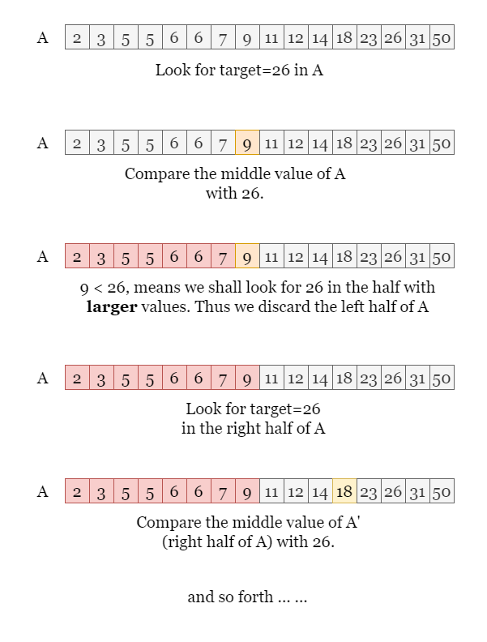

На каждом шаге пространство поиска уменьшается вдвое, поэтому ответ находится быстро. Вернёмся к задаче с двумя отсортированными массивами. Для удобства назовём их `A` и `B`.


Аналогично можно взять и сравнить их средние значения `A_mid` и `B_mid`. Без потери общности в этом примере считаем, что изначально `A_mid <= B_mid`, как показано жёлтыми рамками.

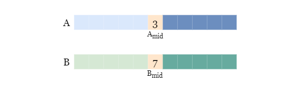

Что даёт это сравнение?

Оно позволяет сравнивать уже целые участки `A` и `B`.

Далее в статье знак `≤` означает относительный порядок значений в массивах. Например, `A_left ≤ A_right` значит, что каждый элемент `A_left` не больше любого элемента `A_right`. Аналогично сравниваем участок массива с одним элементом: `A_left ≤ A_mid` значит, что каждый элемент `A_left` не больше `A_mid`.

Это не самый формальный способ записи, но так проще понимать.

Так как оба массива отсортированы, известно:

- `A_left ≤ A_mid`
- `B_mid ≤ B_right`

Объединяя это со сравнением, которое только что сделали:

- `A_mid ≤ B_mid`

получаем:

- `A_left ≤ A_mid ≤ B_mid ≤ B_right`

и следовательно:

- `A_left ≤ B_right`

Как на картинке ниже:


Поскольку `A` отсортирован, также верно `A_left ≤ A_right`.


Теперь понятно, что `A_left` меньше двух половин: `A_right` и `B_right`. Точные позиции элементов ещё неизвестны, но важно другое: `A_left` не пересекается с `A_right + B_right`! Между сегментом `A_left` и смешанным сегментом `A_right + B_right` есть невидимая граница. На картинке ниже пунктир делит все отсортированные элементы на две половины.


Ту же логику можно применить к смешанному сегменту `A_left + B_left` и к `B_right` — они тоже не пересекаются. Это можно доказать самостоятельно как упражнение.

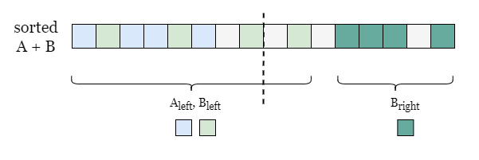

Картина становится яснее: некоторые подотрезки уже разделены. Как продолжать отрезать половины снова и снова?

**Следующий шаг — самый важный.**

Мы ищем медиану отсортированного `A + B` — одно или два целевых значения. Индекс целевого значения в `sorted(A + B)` обозначим как `k`. Например:

- если длины `A` и `B` равны `6` и `5`, то целевой индекс `k = (6 + 5 + 1) / 2 = 6` — ищем 6-й наименьший элемент;
- если длины `A` и `B` равны `6` и `6`, то целевые индексы `k = (6 + 6) / 2 = 6` и `k + 1 = 7` — ищем 6-й и 7-й наименьшие элементы.

В зависимости от чётности общего числа элементов нужны `k`-й (и, возможно, `(k + 1)`-й) элементы. Главное — в начале зафиксировать индекс `k` и искать `k`-й наименьший элемент описанным выше алгоритмом в духе бинарного поиска (для удобства пока говорим только про `k`-й элемент).

Но во время такого поиска мы постоянно удаляем половину одного из массивов, поэтому индекс `k` может меняться. Если удалили `3` элемента, которые были меньше исходного `k`-го наименьшего, дальше нужно искать `(k − 3)`-й наименьший среди оставшихся.


Конкретнее:

- если `k` больше половины числа элементов в `sorted(A + B)`, то `k`-й элемент лежит во второй (большей) половине; значит, `A_left` (или `B_left` — меньшая из двух меньших частей по сравнению) гарантированно его не содержит, эту половину можно отрезать и уменьшить `k` на длину удалённой половины;
- если `k` не больше половины числа элементов в `sorted(A + B)`, то `k`-й элемент лежит в первой (меньшей) половине; значит, `B_right` (или `A_right` — большая из двух больших частей) его не содержит, и её можно отбросить. При этом `k` менять не нужно: удалили большую половину, которая не влияет на порядок `k`-го наименьшего.

Поиск продолжается на оставшихся массивах. Длинная стрелка снизу наверх-влево показывает, что процесс повторяется. Отрезав часть `A` или `B`, оставшееся считаем новыми `A` и `B` и запускаем алгоритм заново. Картинка ниже — только один случай: `a_value < b_value`, поэтому удаляем либо меньшую половину `A`, либо большую половину `B`. Если `a_value >= b_value`, удаляем либо меньшую половину `B`, либо большую половину `A`.

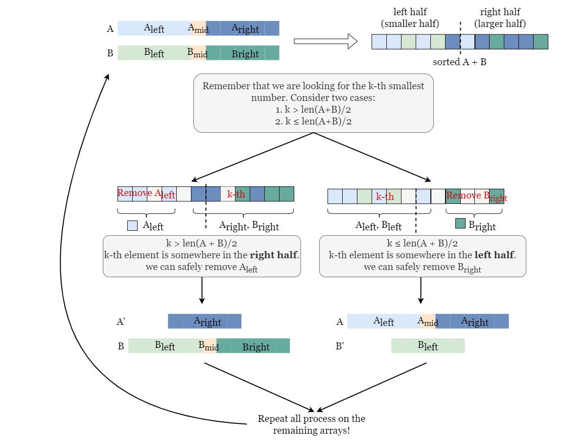

На этом идея готова. На каждом шаге отрезаем половину одного из двух массивов, поэтому сложность логарифмическая — разберём её ниже.

**Ещё один момент!**

На предыдущей картинке для понимания мы как будто создаём новые массивы. На практике копии делать не будем: это дало бы как минимум линейную сложность. Вместо этого на следующем шаге берём часть исходного массива как «новый» массив. Для этого нужны четыре указателя — по два на каждый массив; например, `a_start` и `a_end` задают включительный диапазон `[a_start, a_end]` в `A`.

### Алгоритм

Определим функцию, которая находит `k`-й наименьший элемент в двух включительных диапазонах `[a_start, a_end]` и `[b_start, b_end]` массивов `A` и `B`.

1. Если диапазон (например, у `A`) пуст, то есть `a_start > a_end`, значит все элементы `A` уже пройдены — вернуть `(k - a_start)`-й элемент из другого массива `B`. Аналогично, если `b_start > b_end`.
2. Иначе взять средние индексы диапазонов: `a_index = (a_start + a_end) / 2`, `b_index = (b_start + b_end) / 2`.
3. Взять средние значения: `a_value = A[a_index]`, `b_value = B[b_index]`.
4. Отрезать половину одного массива:
   - если `a_index + b_index < k`, отрезать меньшую половину:
     - если `a_value < b_value` — меньшую половину `A`;
     - иначе — меньшую половину `B`;
   - иначе отрезать большую половину:
     - если `b_value < a_value` — большую половину `B`;
     - иначе — большую половину `A`.
5. Повторить шаг 1 с новыми границами `A` и `B`.

Дальше ищем медиану. Пусть `na = len(A)`, `nb = len(B)`.

- если суммарное число элементов нечётно, вызвать функцию для среднего элемента: `k = (na + nb) / 2`;
- иначе вызвать для двух средних: `k = (na + nb) / 2 - 1` и `k = (na + nb) / 2`, вернуть их среднее.

### Реализация

```javascript
var findMedianSortedArrays = function (A, B) {
    var na = A.length,
        nb = B.length;
    var n = na + nb;

    function solve(A, B, k, aStart, aEnd, bStart, bEnd) {
        // If the segment of one array is empty, it means we have passed all
        // its element, just return the corresponding element in the other array.
        if (aEnd < aStart) {
            return B[k - aStart];
        }
        if (bEnd < bStart) {
            return A[k - bStart];
        }

        // Get the middle indexes and middle values of A and B.
        var aIndex = Math.floor((aStart + aEnd) / 2),
            bIndex = Math.floor((bStart + bEnd) / 2);
        var aValue = A[aIndex],
            bValue = B[bIndex];

        // If k is in the right half of A + B, remove the smaller left half.
        if (aIndex + bIndex < k) {
            if (aValue > bValue) {
                return solve(A, B, k, aStart, aEnd, bIndex + 1, bEnd);
            } else {
                return solve(A, B, k, aIndex + 1, aEnd, bStart, bEnd);
            }
        }
        // Otherwise, remove the larger right half.
        else {
            if (aValue > bValue) {
                return solve(A, B, k, aStart, aIndex - 1, bStart, bEnd);
            } else {
                return solve(A, B, k, aStart, aEnd, bStart, bIndex - 1);
            }
        }
    }

    if (n % 2 == 1) {
        return solve(A, B, Math.floor(n / 2), 0, na - 1, 0, nb - 1);
    } else {
        return (
            (solve(A, B, Math.floor(n / 2 - 1), 0, na - 1, 0, nb - 1) +
                solve(A, B, Math.floor(n / 2), 0, na - 1, 0, nb - 1)) /
            2.0
        );
    }
};
```

```python
class Solution:
    def findMedianSortedArrays(self, A: List[int], B: List[int]) -> float:
        na, nb = len(A), len(B)
        n = na + nb

        def solve(k, a_start, a_end, b_start, b_end):
            # If the segment of on array is empty, it means we have passed all
            # its element, just return the corresponding element in the other array.
            if a_start > a_end:
                return B[k - a_start]
            if b_start > b_end:
                return A[k - b_start]

            # Get the middle indexes and middle values of A and B.
            a_index, b_index = (a_start + a_end) // 2, (b_start + b_end) // 2
            a_value, b_value = A[a_index], B[b_index]

            # If k is in the right half of A + B, remove the smaller left half.
            if a_index + b_index < k:
                if a_value > b_value:
                    return solve(k, a_start, a_end, b_index + 1, b_end)
                else:
                    return solve(k, a_index + 1, a_end, b_start, b_end)
            # Otherwise, remove the larger right half.
            else:
                if a_value > b_value:
                    return solve(k, a_start, a_index - 1, b_start, b_end)
                else:
                    return solve(k, a_start, a_end, b_start, b_index - 1)

        if n % 2:
            return solve(n // 2, 0, na - 1, 0, nb - 1)
        else:
            return (
                solve(n // 2 - 1, 0, na - 1, 0, nb - 1)
                + solve(n // 2, 0, na - 1, 0, nb - 1)
            ) / 2
```

### Анализ сложности

Пусть `m` — размер `nums1`, а `n` — размер `nums2`.

**Время:** `O(log(m · n))`

- На каждом шаге отрезаем половину либо у `nums1`, либо у `nums2`. Если один массив опустел, ответ из другого берётся за константу. Итого время зависит от того, когда один из массивов станет пустым.
- В худшем случае перед нахождением ответа нужно «опустошить» оба массива.
- На каждом шаге один из массивов режется пополам, поэтому опустошение одного массива занимает логарифмическое время. Времена для двух массивов независимы.


Следовательно, временная сложность — `O(log m + log n)`.

`O(log m + log n) = O(log(m · n))`

**Память:** `O(log m + log n)`

- Аналогично анализу по времени: число шагов рекурсии зависит от того, сколько итераций нужно, чтобы опустошить массив. В худшем случае нужно `O(log m + log n)` шагов.
- Во время рекурсии храним только 4 указателя: `a_start`, `a_end`, `b_start`, `b_end`. Последний шаг функции — вызов самой себя, поэтому при оптимизации хвостовой рекурсии стек всегда `O(1)`.

---

## Подход 3: улучшенный бинарный поиск

### Идея

В предыдущем подходе бинарный поиск шёл по «объединённому» массиву из `nums1` и `nums2` со сложностью `O(log(m · n))`. Можно улучшить алгоритм: искать только по меньшему из массивов, тогда сложность станет `O(log(min(m, n)))`.

Основная идея похожа на подход 2: нужно найти точку разбиения обоих массивов так, чтобы максимум меньшей половины был ≤ минимума большей половины.

Но вместо разбиения объединённого массива достаточно разбивать меньший массив (назовём его `A`). Пусть индекс разбиения — `partitionA`. Меньшая половина должна содержать `(m + n + 1) / 2` элементов, поэтому можно сразу взять `partitionB = (m + n + 1) / 2 - partitionA`. Тогда меньшие половины обоих массивов вместе всегда содержат `(m + n + 1) / 2` элементов, как на картинке ниже.

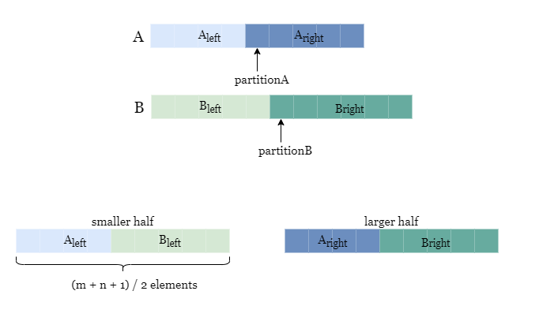

Дальше сравниваем граничные элементы.


Если одновременно верны `maxLeftA <= minRightB` и `maxLeftB <= minRightA`, разбиение найдено правильно.

- Меньшая половина состоит из участков `A_left` и `B_left`.
- Большая половина состоит из участков `A_right` и `B_right`.
- Нужно взять максимум меньшей половины `max(A[maxLeftA], B[maxLeftB])` и минимум большей половины `min(A[minRightA], B[minRightB])`. Медиана зависит от этих четырёх граничных значений и общей длины массивов.


Если `maxLeftA > minRightB`, то `maxLeftA` слишком велик для меньшей половины — нужно искать меньшее значение `partitionA`.


Иначе `minRightA` слишком мал для большей половины — нужно искать большее значение `partitionA`.


### Алгоритм

Считаем `nums1` меньшим массивом (если меньше `nums2`, меняем их местами). Пусть `m`, `n` — размеры `nums1` и `nums2`.

1. Задать пространство поиска для индекса разбиения `partitionA`: `left = 0`, `right = m`.
2. Пока `left <= right`, делать следующее.
3. Вычислить индекс разбиения `nums1`: `partitionA = (left + right) / 2`. Тогда индекс разбиения `nums2`: `(m + n + 1) / 2 - partitionA`.
4. Получить граничные элементы:
   - максимум участка `A_left`: `maxLeftA = nums1[partitionA - 1]`; если `partitionA - 1 < 0`, то `maxLeftA = float(-inf)`;
   - минимум участка `A_right`: `minRightA = nums1[partitionA]`; если `partitionA >= m`, то `minRightA = float(inf)`;
   - максимум участка `B_left`: `maxLeftB = nums2[partitionB - 1]`; если `partitionB - 1 < 0`, то `maxLeftB = float(-inf)`;
   - минимум участка `B_right`: `minRightB = nums2[partitionB]`; если `partitionB >= n`, то `minRightB = float(inf)`.
5. Сравнить и пересчитать: сравнить `maxLeftA` с `minRightB` и `maxLeftB` с `minRightA`.
   - если `maxLeftA > minRightB`, `maxLeftA` слишком велик для меньшей половины — обновить `right = partitionA - 1` и уйти в левую половину пространства поиска;
   - если `maxLeftB > minRightA`, слишком далеко слева для `partitionA` — уйти в правую половину: `left = partitionA + 1`.
6. Повторить шаг 4.
7. Когда одновременно `maxLeftA <= minRightB` и `maxLeftB <= minRightA`:
   - если `(m + n) % 2 = 0`, медиана — среднее максимума меньшей половины и минимума большей: `answer = (max(maxLeftA, maxLeftB) + min(minRightA, minRightB)) / 2`;
   - иначе медиана — максимум меньшей половины: `answer = max(maxLeftA, maxLeftB)`.

### Реализация

```javascript
var findMedianSortedArrays = function (nums1, nums2) {
    if (nums1.length > nums2.length) {
        let temp = nums1;
        nums1 = nums2;
        nums2 = temp;
    }

    let m = nums1.length,
        n = nums2.length;
    let left = 0,
        right = m;

    while (left <= right) {
        let partitionA = Math.floor((left + right) / 2);
        let partitionB = Math.floor((m + n + 1) / 2 - partitionA);

        let maxLeftA =
            partitionA == 0 ? Number.MIN_SAFE_INTEGER : nums1[partitionA - 1];
        let minRightA =
            partitionA == m ? Number.MAX_SAFE_INTEGER : nums1[partitionA];
        let maxLeftB =
            partitionB == 0 ? Number.MIN_SAFE_INTEGER : nums2[partitionB - 1];
        let minRightB =
            partitionB == n ? Number.MAX_SAFE_INTEGER : nums2[partitionB];

        if (maxLeftA <= minRightB && maxLeftB <= minRightA) {
            if ((m + n) % 2 == 0) {
                return (
                    (Math.max(maxLeftA, maxLeftB) +
                        Math.min(minRightA, minRightB)) /
                    2.0
                );
            } else {
                return Math.max(maxLeftA, maxLeftB);
            }
        } else if (maxLeftA > minRightB) {
            right = partitionA - 1;
        } else {
            left = partitionA + 1;
        }
    }
    return 0.0;
};
```

```python
class Solution:
    def findMedianSortedArrays(
        self, nums1: List[int], nums2: List[int]
    ) -> float:
        if len(nums1) > len(nums2):
            return self.findMedianSortedArrays(nums2, nums1)

        m, n = len(nums1), len(nums2)
        left, right = 0, m

        while left <= right:
            partitionA = (left + right) // 2
            partitionB = (m + n + 1) // 2 - partitionA

            maxLeftA = (
                float("-inf") if partitionA == 0 else nums1[partitionA - 1]
            )
            minRightA = float("inf") if partitionA == m else nums1[partitionA]
            maxLeftB = (
                float("-inf") if partitionB == 0 else nums2[partitionB - 1]
            )
            minRightB = float("inf") if partitionB == n else nums2[partitionB]

            if maxLeftA <= minRightB and maxLeftB <= minRightA:
                if (m + n) % 2 == 0:
                    return (
                        max(maxLeftA, maxLeftB) + min(minRightA, minRightB)
                    ) / 2
                else:
                    return max(maxLeftA, maxLeftB)
            elif maxLeftA > minRightB:
                right = partitionA - 1
            else:
                left = partitionA + 1
```

### Анализ сложности

Пусть `m` — размер `nums1`, а `n` — размер `nums2`.

**Время:** `O(log(min(m, n)))`

- Бинарный поиск идёт по меньшему массиву размера `min(m, n)`.

**Память:** `O(1)`

- Нужно лишь константное дополнительное место под несколько параметров бинарного поиска.
