# Median of Two Sorted Arrays

## Solution

### Overview

In this problem, we are given two sorted arrays, `nums1` and `nums2`. We need to return the median of these two arrays.

---

## Approach 1: Merge Sort

### Intuition

Let's start with the straightforward approach. If we put the elements of two arrays in one array `A` and arrange them in order. Assume the merged array has a length of `n`, then the median is:

- `A[n / 2]`, if `n` is odd;
- the average of `A[n / 2]` and `A[n / 2 + 1]`, if `n` is even.

However, we do not really need to merge and sort these arrays. Note that both arrays are already sorted, so the smallest element is either the first element of `nums1` or the first element of `nums2`. Therefore, we can set two pointers `p1` and `p2` at the start of each array, then we can get the smallest element from `nums1` and `nums2` by comparing the values `nums1[p1]` and `nums2[p2]`.

Please refer to the following slides as an example:

**1 / 12**


**2 / 12**

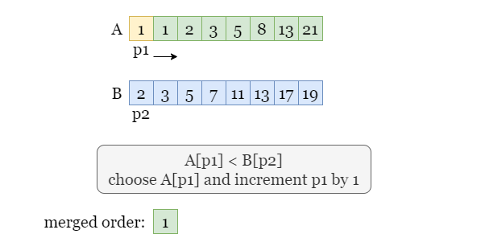

**3 / 12**


**4 / 12**


**5 / 12**


**6 / 12**

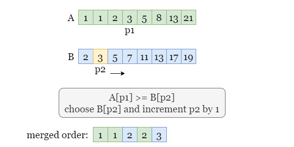

**7 / 12**


**8 / 12**


**9 / 12**

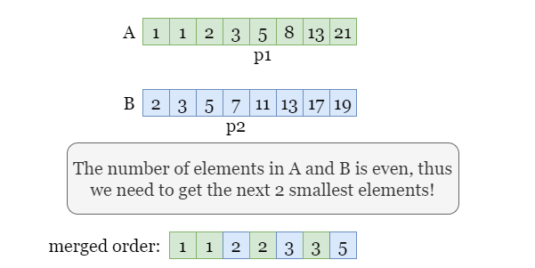

**10 / 12**

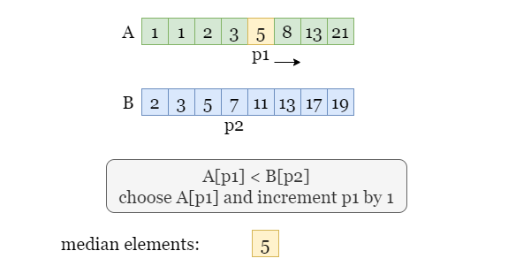

**11 / 12**

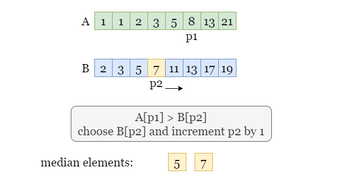

**12 / 12**

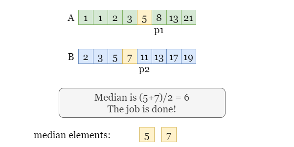

### Algorithm

1. Get the total size of two arrays `m + n`.
   - If `m + n` is odd, we are looking for the `(m + n) / 2`-th element.
   - If `m + n` is even, we are looking for the average of the `(m + n) / 2`-th and the `(m + n) / 2 + 1`-th elements.
2. Set two pointers `p1` and `p2` at the beginning of arrays `nums1` and `nums2`.
3. If both `p1` and `p2` are in bounds of the arrays, compare the values at `p1` and `p2`:
   - If `nums1[p1]` is smaller than `nums2[p2]`, we move `p1` one place to the right.
   - Otherwise, we move `p2` one place to the right.
   - If `p1` is outside `nums1`, just move `p2` one place to the right.
   - If `p2` is outside `nums2`, just move `p1` one place to the right.
4. Get the target elements and calculate the median:
   - If `m + n` is odd, repeat step 3 by `(m + n + 1) / 2` times and return the element from the last step.
   - If `m + n` is even, repeat step 3 by `(m + n) / 2 + 1` times and return the average of the elements from the last two steps.

### Implementation

```javascript
var findMedianSortedArrays = function (nums1, nums2) {
    let m = nums1.length,
        n = nums2.length;
    let p1 = 0,
        p2 = 0;

    let getMin = function () {
        if (p1 < m && p2 < n) {
            return nums1[p1] < nums2[p2] ? nums1[p1++] : nums2[p2++];
        } else if (p1 < m) {
            return nums1[p1++];
        } else if (p2 < n) {
            return nums2[p2++];
        }
        return -1;
    };

    if ((m + n) % 2 === 0) {
        for (let i = 0; i < (m + n) / 2 - 1; ++i) {
            let temp = getMin();
        }
        return (getMin() + getMin()) / 2.0;
    } else {
        for (let i = 0; i < Math.floor((m + n) / 2); ++i) {
            let temp = getMin();
        }
        return getMin();
    }
};
```

```python
class Solution:
    def findMedianSortedArrays(
        self, nums1: List[int], nums2: List[int]
    ) -> float:
        m, n = len(nums1), len(nums2)
        p1, p2 = 0, 0

        # Get the smaller value between nums1[p1] and nums2[p2].
        def get_min():
            nonlocal p1, p2
            if p1 < m and p2 < n:
                if nums1[p1] < nums2[p2]:
                    ans = nums1[p1]
                    p1 += 1
                else:
                    ans = nums2[p2]
                    p2 += 1
            elif p2 == n:
                ans = nums1[p1]
                p1 += 1
            else:
                ans = nums2[p2]
                p2 += 1
            return ans

        if (m + n) % 2 == 0:
            for _ in range((m + n) // 2 - 1):
                _ = get_min()
            return (get_min() + get_min()) / 2
        else:
            for _ in range((m + n) // 2):
                _ = get_min()
            return get_min()
```

### Complexity Analysis

Let `m` be the size of array `nums1` and `n` be the size of array `nums2`.

**Time complexity:** `O(m + n)`

- We get the smallest element by comparing two values at `p1` and `p2`; it takes `O(1)` to compare two elements and move the corresponding pointer to the right.
- We need to traverse half of the arrays before reaching the median element(s).
- To sum up, the time complexity is `O(m + n)`.

**Space complexity:** `O(1)`

- We only need to maintain two pointers `p1` and `p2`.

---

## Approach 2: Binary Search, Recursive

### Intuition

Because the inputs are sorted arrays and the problem asks for a logarithmic time limit, we strongly feel that binary search (or a similar approach) is a promising method. While we're not sure how to cast the same pattern as a normal binary search on this problem, let's go over some steps of a regular binary search and see if we can get any inspiration.

Here we use binary search to find `target` in a sorted array `A`:

1. Locate the middle index (element) of `A`.
2. Compare the value of the middle element with `target`.
3. Reduce the search space by cutting the current array in half and discarding the half which is guaranteed not to contain `target`.
4. Repeat the above process until we either empty the array (move to half of length `0`) or find `target`.


At each step, the search space is cut in half, so we can quickly get the result. Now back to this problem where we have two sorted arrays. For the sake of convenience, let's call them `A` and `B`.

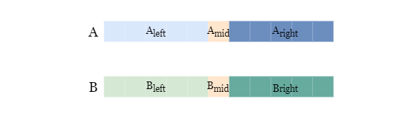

Similarly, we can get and compare their middle values `A_mid` and `B_mid`. Without loss of generality in this example we assume `A_mid <= B_mid` initially, as shown in the yellow boxes.


What does this comparison imply?

It implies that we can compare sections of `A` and `B`.

For the rest of this article, we will use `≤` to represent the relative magnitude of values in arrays. For example, `A_left ≤ A_right` means that every element in `A_left` is no larger than any element in `A_right`. We also "compare" elements in an array with a single element similarly, for example, `A_left ≤ A_mid` means that every element in `A_left` is no larger than the element `A_mid`.

This may not be the most standard way of expressing it, but is easy enough to understand.

Recall that both arrays are sorted, so we know that:

- `A_left ≤ A_mid`
- `B_mid ≤ B_right`

Combine these observations with the comparison we just made:

- `A_mid ≤ B_mid`

We have the following result:

- `A_left ≤ A_mid ≤ B_mid ≤ B_right`

Thus:

- `A_left ≤ B_right`

As shown in the picture below:

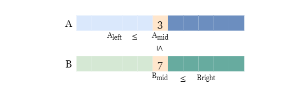

Since `A` is sorted, we know that `A_left ≤ A_right`.

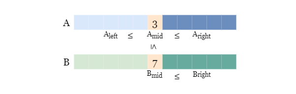

Now we know that `A_left` is smaller than two halves: `A_right` and `B_right`. Although we still don't know where exactly these elements are, what we do know is `A_left` doesn't intersect with `A_right + B_right`! There is an invisible boundary between the `A_left` segment and the mixed segment `A_right + B_right`. As shown in the picture below, the dashed line divides all sorted elements into two halves.

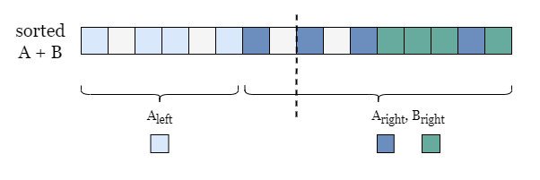

We can apply all the same logic to the mixed segment `A_left + B_left` and `B_right`, which also do not intersect. You can try to prove it yourself as an exercise.


It looks somewhat clearer: we have clearly separated some subarrays. How do we continue to leverage this knowledge and use the cut-in-half method repeatedly?

**The following step is the most important one.**

Remember that we are looking for the median of sorted `A + B`, which is one or two target values. We regard the index of the target value in `sorted(A + B)` as `k`. For example:

- If the lengths of `A` and `B` are `6` and `5`, the target index is `k = (6 + 5 + 1) / 2 = 6`, we shall look for the 6th smallest element.
- If the lengths of `A` and `B` are `6` and `6`, the target indexes are `k = (6 + 6) / 2 = 6` and `k + 1 = 7`, we shall look for the 6th and the 7th smallest elements.

Depending on whether the total number of elements is odd or even, we need the `k`-th (and maybe the `(k + 1)`-th) elements. What matters is that we set an index `k` at the beginning and we want to find the `k`-th smallest element using the binary-search-like algorithm discussed previously (for convenience, we will discuss only the `k`-th element for now).

However, during the binary-search-like algorithm, we keep removing one half of an array, so the index `k` might not stay unchanged. Suppose we removed `3` elements that are smaller than the original `k`-th smallest element, we shall look for the `(k − 3)`-th smallest element from the remaining arrays.

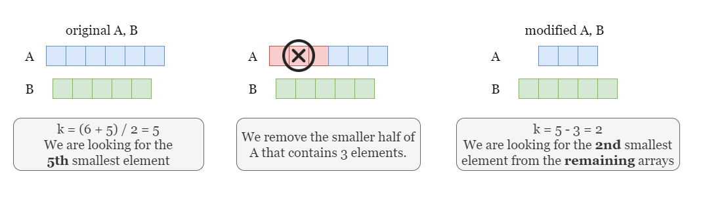

More specifically:

- If `k` is larger than half the total number of elements in `sorted(A + B)`, it means that the `k`-th element is in the second (larger) half of `sorted(A + B)`, thus `A_left` (or `B_left`, the smaller of the two smaller sections according to the comparison) is guaranteed not to contain this element, and we can safely cut this half, and reduce `k` by the length of the removed half.
- If `k` is not larger than half the total number of elements in `sorted(A + B)`, it means that the `k`-th element is in the first (smaller) half of `sorted(A + B)`, thus `B_right` (or `A_right`, the larger of the two larger sections according to the comparison) is guaranteed not to contain this element, and we can safely discard it. Note that we don't need to modify `k` this time, since we removed one larger half that doesn't affect the order of the `k`-th smallest element.

We can continue our search like above in the remaining arrays. The long arrow that starts from the bottom and points to the top-left indicates that we are repeating the process. Once we cut off part of either `A` or `B`, we regard the remaining arrays as modified `A` and `B` and restart this algorithm. Note that the following picture represents one case only: we consider the case that `a_value < b_value`, thus we remove either the smaller half of `A` or the larger half of `B`. If the comparison result is `a_value >= b_value`, we shall remove either the smaller half of `B` or the larger half of `A`.


That's it. We cut one of the two arrays in half at each step, so this approach has a logarithmic time complexity which we will discuss in detail later.

**One more thing!**

In the previous picture, we repeat all processes using the modified arrays, but this is just for the sake of understanding. We won't create copies of two arrays repeatedly, because that would introduce a linear time complexity at least. Instead, we just treat a part of the original array as the modified array for the next step, so that we can repeat the process on the original array without making any duplication. To do this, we need to maintain four pointers, two pointers for each array, e.g., `a_start` and `a_end` represent an inclusive range `[a_start, a_end]` of `A`.

### Algorithm

Let's define a function that helps us find the `k`-th smallest element from two inclusive ranges `[a_start, a_end]` and `[b_start, b_end]` from arrays `A` and `B`.

1. If the range (for example, a range of `A`) is empty, in other words `a_start > a_end`, it means all elements in `A` are passed, we just return the `(k - a_start)`-th element from the other array `B`. Vice versa if `b_start > b_end`.
2. Otherwise, get the middle indexes of the two ranges: `a_index = (a_start + a_end) / 2`, `b_index = (b_start + b_end) / 2`.
3. Get the middle values of the two ranges: `a_value = A[a_index]`, `b_value = B[b_index]`.
4. Cut one array in half, according to:
   - If `a_index + b_index < k`, cut one smaller half:
     - If `a_value < b_value`, cut the smaller half of `A`.
     - Otherwise, cut the smaller half of `B`.
   - Otherwise, cut one larger half:
     - If `b_value < a_value`, cut the larger half of `B`.
     - Otherwise, cut the larger half of `A`.
5. Repeat step 1 using the new starting and ending indexes of `A` and `B`.

Then we move on to find the median elements, and get the length of both arrays `na = len(A)` and `nb = len(B)`.

- If the total number of elements in `A` and `B` is odd, we just use the above function to find the middle element, that is `k = (na + nb) / 2`.
- Otherwise, we use the function to find two middle elements: `k = (na + nb) / 2 - 1` and `k = (na + nb) / 2`, and return their average.


### Implementation

```javascript
var findMedianSortedArrays = function (A, B) {
    var na = A.length,
        nb = B.length;
    var n = na + nb;

    function solve(A, B, k, aStart, aEnd, bStart, bEnd) {
        // If the segment of one array is empty, it means we have passed all
        // its element, just return the corresponding element in the other array.
        if (aEnd < aStart) {
            return B[k - aStart];
        }
        if (bEnd < bStart) {
            return A[k - bStart];
        }

        // Get the middle indexes and middle values of A and B.
        var aIndex = Math.floor((aStart + aEnd) / 2),
            bIndex = Math.floor((bStart + bEnd) / 2);
        var aValue = A[aIndex],
            bValue = B[bIndex];

        // If k is in the right half of A + B, remove the smaller left half.
        if (aIndex + bIndex < k) {
            if (aValue > bValue) {
                return solve(A, B, k, aStart, aEnd, bIndex + 1, bEnd);
            } else {
                return solve(A, B, k, aIndex + 1, aEnd, bStart, bEnd);
            }
        }
        // Otherwise, remove the larger right half.
        else {
            if (aValue > bValue) {
                return solve(A, B, k, aStart, aIndex - 1, bStart, bEnd);
            } else {
                return solve(A, B, k, aStart, aEnd, bStart, bIndex - 1);
            }
        }
    }

    if (n % 2 == 1) {
        return solve(A, B, Math.floor(n / 2), 0, na - 1, 0, nb - 1);
    } else {
        return (
            (solve(A, B, Math.floor(n / 2 - 1), 0, na - 1, 0, nb - 1) +
                solve(A, B, Math.floor(n / 2), 0, na - 1, 0, nb - 1)) /
            2.0
        );
    }
};
```

```python
class Solution:
    def findMedianSortedArrays(self, A: List[int], B: List[int]) -> float:
        na, nb = len(A), len(B)
        n = na + nb

        def solve(k, a_start, a_end, b_start, b_end):
            # If the segment of on array is empty, it means we have passed all
            # its element, just return the corresponding element in the other array.
            if a_start > a_end:
                return B[k - a_start]
            if b_start > b_end:
                return A[k - b_start]

            # Get the middle indexes and middle values of A and B.
            a_index, b_index = (a_start + a_end) // 2, (b_start + b_end) // 2
            a_value, b_value = A[a_index], B[b_index]

            # If k is in the right half of A + B, remove the smaller left half.
            if a_index + b_index < k:
                if a_value > b_value:
                    return solve(k, a_start, a_end, b_index + 1, b_end)
                else:
                    return solve(k, a_index + 1, a_end, b_start, b_end)
            # Otherwise, remove the larger right half.
            else:
                if a_value > b_value:
                    return solve(k, a_start, a_index - 1, b_start, b_end)
                else:
                    return solve(k, a_start, a_end, b_start, b_index - 1)

        if n % 2:
            return solve(n // 2, 0, na - 1, 0, nb - 1)
        else:
            return (
                solve(n // 2 - 1, 0, na - 1, 0, nb - 1)
                + solve(n // 2, 0, na - 1, 0, nb - 1)
            ) / 2
```

### Complexity Analysis

Let `m` be the size of array `nums1` and `n` be the size of array `nums2`.

**Time complexity:** `O(log(m · n))`

- At each step, we cut one half off from either `nums1` or `nums2`. If one of the arrays is emptied, we can directly get the target from the other array in a constant time. Therefore, the total time spent depends on when one of the arrays is cut into an empty array.
- In the worst-case scenario, we may need to cut both arrays before finding the target element.
- One of the two arrays is cut in half at each step, thus it takes logarithmic time to empty an array. The time to empty two arrays are independent of each other.

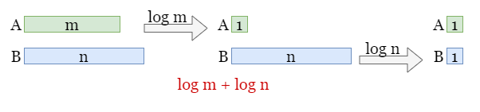

Therefore, the time complexity is `O(log m + log n)`.

`O(log m + log n) = O(log(m · n))`

**Space complexity:** `O(log m + log n)`

- Similar to the analysis on time complexity, the recursion steps depend on the number of iterations before we cut an array into an empty array. In the worst-case scenario, we need `O(log m + log n)` recursion steps.
- However, during the recursive self-call, we only need to maintain 4 pointers: `a_start`, `a_end`, `b_start` and `b_end`. The last step of the function is to call itself, so if tail call optimization is implemented, the call stack always has `O(1)` records.

---

## Approach 3: A Better Binary Search

### Intuition

Recall the previous approach where we perform a binary search over the "merged" array consisting of `nums1` and `nums2`, resulting in a time complexity of `O(log(m · n))`. We could further improve the algorithm by performing the binary search only on the smaller array of `nums1` and `nums2`, thus the time complexity is reduced to `O(log(min(m, n)))`.

The main idea is similar to approach 2, where we need to find a point of partition in both arrays such that the maximum of the smaller half is less than or equal to the minimum of the larger half.

However, instead of partitioning over the merged arrays, we can only focus on partitioning the smaller array (let's call this array `A`). Suppose the partition index is `partitionA`, we specify that the smaller half contains `(m + n + 1) / 2` elements, and we can use this feature to our advantage by directly making `partitionB` equal to `(m + n + 1) / 2 - partitionA`, thus the smaller halves of both arrays always contain a total of `(m + n + 1) / 2` elements, as shown in the picture below.


The next step is to compare these edge elements.

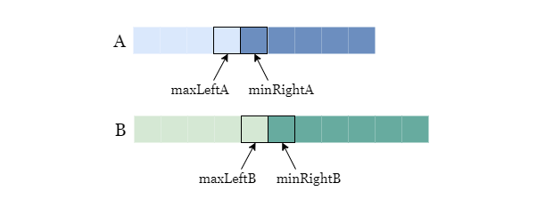

If both `maxLeftA <= minRightB` and `maxLeftB <= minRightA` hold, it means that we have partitioned arrays at the correct place.

- The smaller half consists of two sections `A_left` and `B_left`.
- The larger half consists of two sections `A_right` and `B_right`.
- We just need to find the maximum value from the smaller half as `max(A[maxLeftA], B[maxLeftB])` and the minimum value from the larger half as `min(A[minRightA], B[minRightB])`. The median value depends on these four boundary values and the total length of the input arrays and we can compute it by situation.

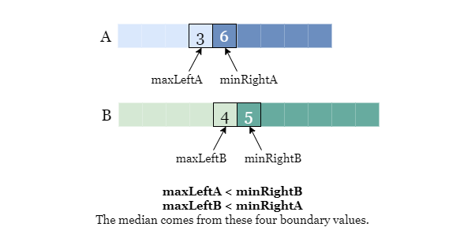

If `maxLeftA > minRightB`, it implies that `maxLeftA` is too large to be in the smaller half and we should look for a smaller partition value of `A`.

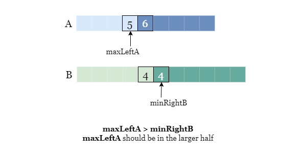

Otherwise, it denotes that `minRightA` is too small to be in the larger half and we should look for a larger partition value of `A`.

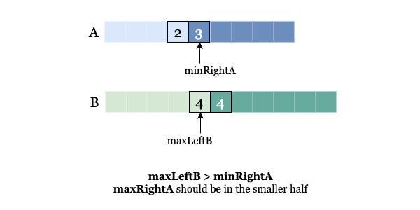

### Algorithm

Assuming `nums1` to be the smaller array (If `nums2` is smaller, we can swap them). Let `m`, `n` represent the size of `nums1` and `nums2`, respectively.

1. Define the search space for the partitioning index `partitionA` by setting boundaries as `left = 0` and `right = m`.
2. While `left <= right` holds, do the following.
3. Compute the partition index of `nums1` as `partitionA = (left + right) / 2`. Consequently, the partition index of `nums2` is `(m + n + 1) / 2 - partitionA`.
4. Obtain the edge elements:
   - Determine the maximum value of the section `A_left` as `maxLeftA = nums1[partitionA - 1]`. If `partitionA - 1 < 0`, set it as `maxLeftA = float(-inf)`.
   - Determine the minimum value of the section `A_right` as `minRightA = nums1[partitionA]`. If `partitionA >= m`, set it as `minRightA = float(inf)`.
   - Determine the maximum value of the section `B_left` as `maxLeftB = nums2[partitionB - 1]`. If `partitionB - 1 < 0`, set it as `maxLeftB = float(-inf)`.
   - Determine the minimum value of the section `B_right` as `minRightB = nums2[partitionB]`. If `partitionB >= n`, set it as `minRightB = float(inf)`.
5. Compare and recalculate: compare `maxLeftA` with `minRightB` and `maxLeftB` with `minRightA`.
   - If `maxLeftA > minRightB`, it means the `maxLeftA` is too large to be in the smaller half, so we update `right = partitionA - 1` to move to the left half of the search space.
   - If `maxLeftB > minRightA`, it means that we are too far on the left side for `partitionA` and we need to go to the right half of the search space by updating `left = partitionA + 1`.
6. Repeat step 4.
7. When both `maxLeftA <= minRightB` and `maxLeftB <= minRightA` are true:
   - If `(m + n) % 2 = 0`, the median value is the average of the maximum value of the smaller half and the minimum value of the larger half, given by `answer = (max(maxLeftA, maxLeftB) + min(minRightA, minRightB)) / 2`.
   - Otherwise, the median value is the maximum value of the smaller half, given by `answer = max(maxLeftA, maxLeftB)`.

### Implementation

```javascript
var findMedianSortedArrays = function (nums1, nums2) {
    if (nums1.length > nums2.length) {
        let temp = nums1;
        nums1 = nums2;
        nums2 = temp;
    }

    let m = nums1.length,
        n = nums2.length;
    let left = 0,
        right = m;

    while (left <= right) {
        let partitionA = Math.floor((left + right) / 2);
        let partitionB = Math.floor((m + n + 1) / 2 - partitionA);

        let maxLeftA =
            partitionA == 0 ? Number.MIN_SAFE_INTEGER : nums1[partitionA - 1];
        let minRightA =
            partitionA == m ? Number.MAX_SAFE_INTEGER : nums1[partitionA];
        let maxLeftB =
            partitionB == 0 ? Number.MIN_SAFE_INTEGER : nums2[partitionB - 1];
        let minRightB =
            partitionB == n ? Number.MAX_SAFE_INTEGER : nums2[partitionB];

        if (maxLeftA <= minRightB && maxLeftB <= minRightA) {
            if ((m + n) % 2 == 0) {
                return (
                    (Math.max(maxLeftA, maxLeftB) +
                        Math.min(minRightA, minRightB)) /
                    2.0
                );
            } else {
                return Math.max(maxLeftA, maxLeftB);
            }
        } else if (maxLeftA > minRightB) {
            right = partitionA - 1;
        } else {
            left = partitionA + 1;
        }
    }
    return 0.0;
};
```

```python
class Solution:
    def findMedianSortedArrays(
        self, nums1: List[int], nums2: List[int]
    ) -> float:
        if len(nums1) > len(nums2):
            return self.findMedianSortedArrays(nums2, nums1)

        m, n = len(nums1), len(nums2)
        left, right = 0, m

        while left <= right:
            partitionA = (left + right) // 2
            partitionB = (m + n + 1) // 2 - partitionA

            maxLeftA = (
                float("-inf") if partitionA == 0 else nums1[partitionA - 1]
            )
            minRightA = float("inf") if partitionA == m else nums1[partitionA]
            maxLeftB = (
                float("-inf") if partitionB == 0 else nums2[partitionB - 1]
            )
            minRightB = float("inf") if partitionB == n else nums2[partitionB]

            if maxLeftA <= minRightB and maxLeftB <= minRightA:
                if (m + n) % 2 == 0:
                    return (
                        max(maxLeftA, maxLeftB) + min(minRightA, minRightB)
                    ) / 2
                else:
                    return max(maxLeftA, maxLeftB)
            elif maxLeftA > minRightB:
                right = partitionA - 1
            else:
                left = partitionA + 1
```

### Complexity Analysis

Let `m` be the size of array `nums1` and `n` be the size of array `nums2`.

**Time complexity:** `O(log(min(m, n)))`

- We perform a binary search over the smaller array of size `min(m, n)`.

**Space complexity:** `O(1)`

- The algorithm only requires a constant amount of additional space to store and update a few parameters during the binary search.
