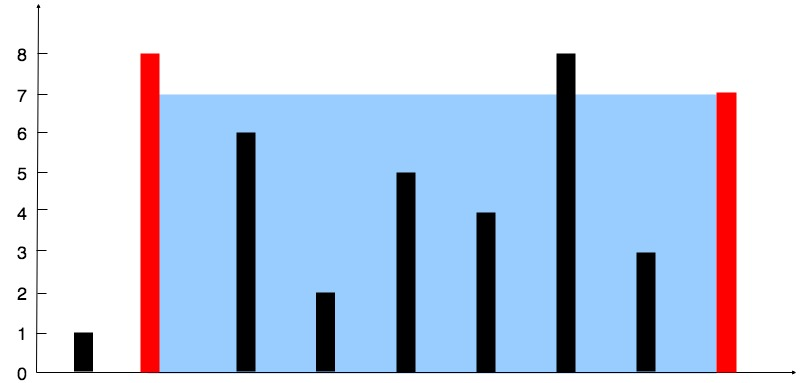

# 11. Container With Most Water (Medium)

Дан целочисленный массив `height` длины `n`. Нарисованы `n` вертикальных линий: концы `i`-й линии — `(i, 0)` и `(i, height[i])`.

Найдите две линии, которые вместе с осью x образуют контейнер, вмещающий наибольшее количество воды.

Верните максимальный объём воды, который может вместить контейнер.

Контейнер нельзя наклонять.

## Пример 1

Вход: height = [1,8,6,2,5,4,8,3,7]

Выход: 49

Пояснение: вертикальные линии заданы массивом `[1,8,6,2,5,4,8,3,7]`. Максимальная площадь воды (синяя область) равна 49.

## Пример 2

Вход: height = [1,1]

Выход: 1

## Ограничения

- n == height.length
- 2 <= n <= 10^5
- 0 <= height[i] <= 10^4
